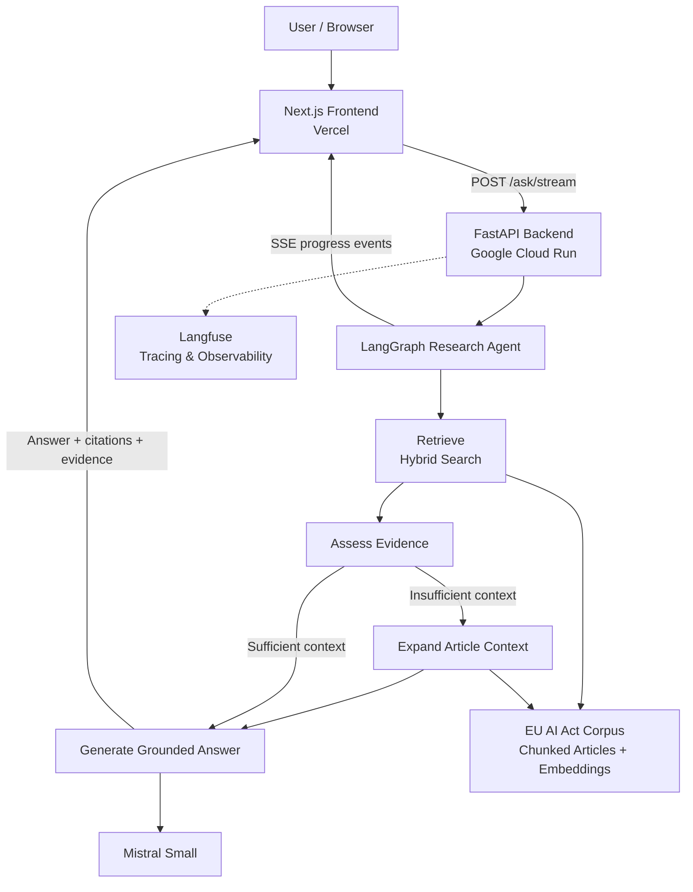

# EU AI Act Intelligence Lab

### Evidence-grounded regulatory research with Agentic RAG

A deployed AI research application that investigates the **EU AI Act (Regulation (EU) 2024/1689)** using a stateful **LangGraph agent**, hybrid retrieval, and **Mistral**.

Instead of returning an answer from a single retrieval pass, the agent evaluates the available evidence, decides whether additional context is needed, and generates an answer grounded in the regulation.

The application exposes this process through a live research interface with streaming agent progress, article citations, and an evidence inspector.

<div align="center">

## 🚀 EXPERIENCE THE LIVE AI AGENT

<a href="https://eu-ai-act-agentic-rag.vercel.app">
  
</a>

### 🌐 [eu-ai-act-agentic-rag.vercel.app](https://eu-ai-act-agentic-rag.vercel.app)

**Ask questions · Watch LangGraph execute · Inspect real EU AI Act evidence**

</div>

---

## 📊 Four RAG Architectures. One Benchmark. A Surprising Trade-off.

**40 held-out questions · 160 attempted executions · 35 complete paired questions**

Rather than assuming agentic RAG always outperforms simpler approaches, this project compares four architectures on the same regulatory research benchmark.

### Benchmark Results

| Architecture | Citation F1 ↑ | Execution success ↑ | Mean latency ↓ | Mean tokens ↓ |
|---|---:|---:|---:|---:|
| Naive RAG | 0.6134 | 95.0% | 1.602 s | 1,838 |
| Expanded RAG (no agent) | 0.7629 | 92.5% | 1.720 s | 2,326 |
| Deterministic LangGraph | 0.6320 | **100.0%** | **1.532 s** | 1,897 |
| LLM-driven LangGraph | **0.7932** | 97.5% | 2.917 s | 4,549 |

*Citation F1 is calculated on the 35-question complete paired subset. Execution success covers all attempted questions. Latency and token figures are reported means, not guaranteed production response times.*

### 🔍 Key Finding: Context Expansion Matters More Than Agentic Complexity

Expanding the retrieved article context improves citation F1 from **0.6134 to 0.7629**, without requiring an agent.

LLM-driven LangGraph achieves the highest reported citation F1 (**0.7932**), but its additional improvement over expanded RAG is only **0.0303**, while using approximately **96% more tokens** and taking approximately **70% longer**.

**The engineering lesson:** More agentic complexity is not automatically better. The right architecture depends on the trade-off between citation quality, latency, reliability, and inference cost.

### Evaluation Methodology and Caveats

- Four architectures were evaluated against the same 40-question held-out benchmark.
- The benchmark contains 160 attempted executions.
- Citation F1 comparisons use 35 questions with complete paired results.
- Execution success rates include failed attempts.
- Citation F1 measures article-reference quality, **not semantic answer correctness**.
- The observed 0.0303 advantage of LLM-driven LangGraph over expanded RAG has not been established as statistically significant.
- The results describe this dataset and configuration; they are not universal claims about RAG architectures.

**Reproducibility artifacts:**

- [`scripts/benchmark_four_strategies.py`](scripts/benchmark_four_strategies.py)
- [`scripts/final_benchmark_report.py`](scripts/final_benchmark_report.py)
- [`evals/results/four_way_test_20261020T231531Z.jsonl`](evals/results/four_way_test_20261020T231531Z.jsonl)
- [`evals/results/four_way_test_20261020T231531Z.final_report.json`](evals/results/four_way_test_20261020T231531Z.final_report.json)

The live application includes an interactive benchmark dashboard for comparing citation F1, execution success, latency, and token usage.

---

## What Makes This Project Different?

- **Agentic retrieval:** A LangGraph workflow evaluates evidence before generating an answer.
- **Adaptive context expansion:** The agent can retrieve additional article context when the initial evidence is insufficient.
- **Hybrid RAG:** Semantic retrieval and lexical matching help identify relevant regulatory passages.
- **Evidence-grounded answers:** Responses reference relevant EU AI Act articles.
- **Live execution visibility:** Server-Sent Events stream agent progress to the frontend.
- **Evidence inspection:** Users can examine supporting passages and navigate to regulatory articles.
- **Observability:** Langfuse provides tracing for backend agent executions.
- **Cloud deployment:** FastAPI runs on Google Cloud Run, while Next.js runs on Vercel.
- **Cost-aware infrastructure:** Cloud Run scales to zero when idle.

---

## Live Application

**Frontend:** https://eu-ai-act-agentic-rag.vercel.app

**Backend health endpoint:** https://eu-ai-act-api-lovrur2jma-od.a.run.app/health

Try asking:

> Which AI practices are prohibited under Article 5?

> What obligations apply to providers of high-risk AI systems under Article 16?

> What transparency obligations apply under Article 50?

The interface shows the agent's execution progress, final answer, citations, and available supporting evidence.

**Note:** The backend uses Google Cloud Run's scale-to-zero configuration. After inactivity, the first request may take approximately 15–25 seconds while the service starts. Subsequent requests are typically faster.

---

## System Architecture



### End-to-End Flow

1. A user submits a regulatory question.
2. FastAPI starts the LangGraph research workflow.
3. The retrieval stage identifies relevant passages using hybrid search.
4. The assessment stage evaluates whether the retrieved context is sufficient.
5. If needed, the agent expands the context using additional article text.
6. Mistral generates a response grounded in the selected evidence.
7. The backend streams execution updates and the completed result.
8. The frontend displays the answer, citations, and supporting passages.

This approach separates **retrieval, evidence assessment, context expansion, and answer generation** rather than treating retrieval as a single opaque operation.

---

## Technology Stack

| Layer | Technology |
|---|---|
| Frontend | Next.js, React, TypeScript, Tailwind CSS |
| Backend | Python, FastAPI |
| Agent orchestration | LangGraph |
| Language model | Mistral Small |
| Retrieval | Hybrid semantic and lexical search |
| Embeddings | Sentence Transformers (`all-MiniLM-L6-v2`) |
| Streaming | Server-Sent Events (SSE) |
| Observability | Langfuse |
| Backend hosting | Google Cloud Run |
| Frontend hosting | Vercel |
| Containerization | Docker |
| Secrets | Google Cloud Secret Manager |

---

## Agentic RAG Workflow

The central design decision is to make **evidence sufficiency an explicit step** in the research process.

### 1. Retrieve

The system searches the indexed EU AI Act corpus for passages relevant to the user's question.

### 2. Assess

The agent evaluates the retrieved evidence and determines whether the available context is sufficient for answering.

### 3. Expand When Needed

If the retrieved passages are incomplete, the workflow can expand the context using the relevant article text.

### 4. Generate

Mistral produces an evidence-grounded answer with article references.

### 5. Inspect

The frontend exposes supporting passages so users can examine the regulatory basis of the response.

**Why this matters:** Regulatory questions often depend on definitions, exceptions, conditions, and obligations that may not fit into a single retrieved chunk.

---

## EU AI Act Knowledge Base

The research corpus is derived from:

**Regulation (EU) 2024/1689 — Artificial Intelligence Act**

Official source:

https://eur-lex.europa.eu/eli/reg/2024/1689/oj/eng

The current indexed dataset contains:

- **113 articles**
- **324 text chunks**
- Precomputed sentence-transformer embeddings

Precomputing embeddings avoids regenerating the document vectors every time the deployed container starts.

**Scope:** The indexed corpus focuses on article text. The application should not be treated as a complete representation of every annex, amendment, or subsequent legal development.

---

## Streaming Research Interface

The frontend consumes the backend's streaming endpoint:

```http
POST /ask/stream
Content-Type: application/json
```

Example request:

```json
{
  "question": "What obligations apply to providers of high-risk AI systems under Article 16?"
}
```

The API emits Server-Sent Events as the agent progresses.

The interface uses these events to display completed workflow steps and the final research result.

### API Endpoints

| Endpoint | Purpose |
|---|---|
| `GET /health` | Service health check |
| `POST /ask` | Non-streaming research request |
| `POST /ask/stream` | Streaming research request |
| `GET /evidence/articles/{number}` | Retrieve article evidence |

---

## Cloud Deployment

### Frontend — Vercel

The Next.js application is deployed on Vercel and configured with the public backend URL through `NEXT_PUBLIC_API_URL`.

### Backend — Google Cloud Run

The FastAPI service runs in a Docker container on Google Cloud Run in the **Paris region (`europe-west9`)**.

The deployment is configured for cost-aware operation:

| Setting | Configuration |
|---|---|
| CPU | 1 vCPU |
| Memory | 2 GiB |
| Minimum instances | 0 |
| Maximum instances | 1 |
| Request concurrency | 4 |
| Request timeout | 120 seconds |
| Billing behavior | Request-based CPU allocation |

### Why Scale to Zero?

This is a portfolio application rather than a continuously loaded production service.

Keeping zero minimum instances avoids paying to keep the container continuously running when nobody is using the application.

The trade-off is **cold-start latency**.

When Cloud Run starts a new instance, it must initialize the Python application and load the embedding model before handling the request.

The frontend explains this behavior with an initialization notice so users understand why the first investigation may take longer.

### Secrets and Configuration

Backend API credentials are stored in **Google Cloud Secret Manager** and provided to the Cloud Run service at runtime.

The frontend only receives the public backend URL.

No API keys should be committed to the repository or exposed through `NEXT_PUBLIC_*` variables.

---

## Running Locally

### Prerequisites

- Python 3.12
- Node.js and npm
- A Mistral API key
- Backend environment variables configured for your local environment

### 1. Clone the Repository

```bash
git clone https://github.com/revanthpuvanes/eu-ai-act-agentic-rag.git

cd eu-ai-act-agentic-rag
```

### 2. Start the Backend

Create a Python virtual environment:

```bash
python3.12 -m venv .venv

source .venv/bin/activate
```

Install the backend dependencies using the dependency file provided in the repository.

Configure the required environment variables, including your Mistral API credentials.

Start FastAPI:

```bash
uvicorn src.api.app:app --reload --port 8000
```

The backend will be available at:

```text
http://127.0.0.1:8000
```

### 3. Start the Frontend

Open a second terminal:

```bash
cd web

npm install
```

Create `web/.env.local`:

```env
NEXT_PUBLIC_API_URL=http://127.0.0.1:8000
```

Start Next.js:

```bash
npm run dev
```

Open:

```text
http://localhost:3000
```

The frontend will send research requests to your local FastAPI backend.

---

## Evaluation and Observability

### Recorded Benchmark

The four-strategy benchmark results, methodology, and limitations are documented near the top of this README.

The evaluation implementation also tracks execution failures and distinguishes reliability across all attempts from citation metrics on complete paired questions.

### Security Evaluation

The repository includes prompt-injection and attack-exposure evaluation scripts and recorded test artifacts.

These experiments are separate from the four-strategy citation benchmark. Their presence does not imply comprehensive prompt-injection resistance.

### Langfuse

Langfuse provides backend execution tracing and observability for inspecting the research workflow and diagnosing agent behavior.

---

## Engineering Trade-offs

| Decision | Benefit | Trade-off |
|---|---|---|
| LangGraph workflow | Explicit, inspectable research stages | More orchestration complexity |
| Hybrid retrieval | Combines semantic and lexical signals | Additional retrieval logic |
| Context expansion | Recovers evidence beyond initial chunks | Can increase latency and token usage |
| Precomputed embeddings | Avoids document embedding work at startup | Requires refreshing artifacts when the corpus changes |
| SSE streaming | Makes agent progress visible | Requires stream handling in frontend and backend |
| Cloud Run scale-to-zero | Reduces idle infrastructure cost | First request may experience a cold start |
| Public demo API | Easy for recruiters to try | Requires ongoing attention to abuse prevention and usage costs |

---

## Limitations and Responsible Use

This application is a **technical research demonstration**, not a substitute for legal advice.

- Generated answers may be incomplete or incorrect.
- Article citations should be checked against the official regulation.
- The current indexed corpus does not guarantee complete coverage of annexes or later legal changes.
- Evidence assessment and context expansion improve the research workflow but do not guarantee factual correctness.
- Cloud Run scale-to-zero introduces cold-start latency.
- The public demo has infrastructure limits but is not guaranteed to have comprehensive abuse protection or a hard API spending cap.

For authoritative interpretation, consult the official legal text and qualified legal professionals.

---

## Future Improvements

- Extend retrieval coverage to annexes and related legal materials.
- Build a manually verified evaluation dataset.
- Compare baseline RAG and agentic RAG using reproducible metrics.
- Add stronger public API abuse controls and spending safeguards.
- Improve retrieval and answer quality on cross-article questions.
- Track changes to the regulation and refresh indexed evidence.

---

## Project Purpose

This project explores how **agentic workflows, retrieval-augmented generation, observability, and serverless deployment** can be combined into an inspectable AI research system.

The focus is not simply generating answers, but engineering the surrounding system:

**retrieval → evidence assessment → adaptive context → grounded generation → user inspection.**

---

**Built with LangGraph, FastAPI, Mistral, Next.js, Langfuse, and Google Cloud Run.**

**[Try the Live Application](https://eu-ai-act-agentic-rag.vercel.app)**
