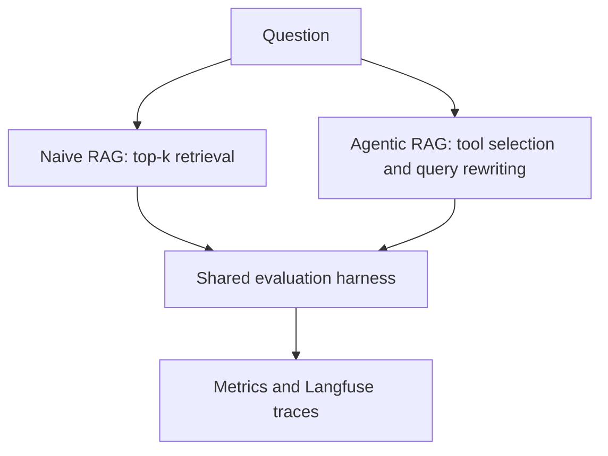

# EU AI Act — Evaluated Agentic RAG

**Live demo:** Not deployed yet.

## Architecture

## Results

| Metric | Naive RAG | Agentic RAG |
|---|---|---|
| Answer correctness | Not measured | Not measured |
| Citation accuracy | Not measured | Not measured |
| Retrieval hit@k | Not measured | Not measured |
| Median latency | Not measured | Not measured |
| Cost per question | Not measured | Not measured |
| Injection resistance | Not measured | Not measured |

## Source
Regulation (EU) 2024/1689, official consolidated reference: https://eur-lex.europa.eu/eli/reg/2024/1689/oj/eng

## Evaluation protocol
Create and manually verify 50–100 questions with article-level source references before implementing retrieval or agents. Freeze the test split and record its SHA-256 hash. Never tune against the held-out test set. Store injection cases separately. Metrics will only be filled from actual recorded runs.

## Security requirements before deployment
Per-IP rate limiting, input length caps, daily spend cap, request timeout, no real outbound actions, and public trace sanitization.
